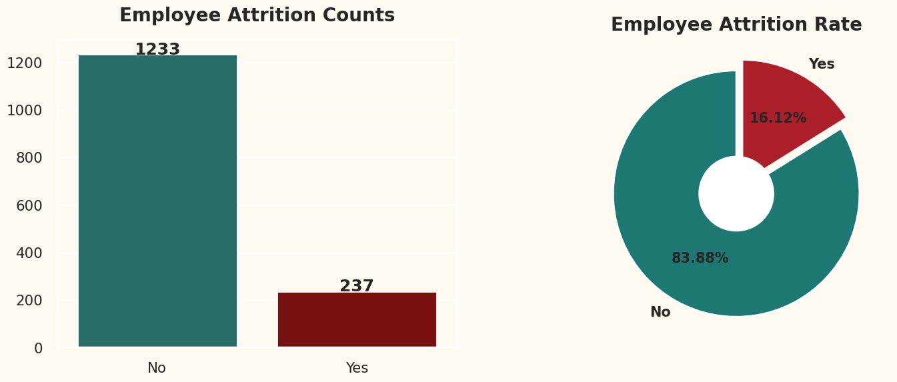
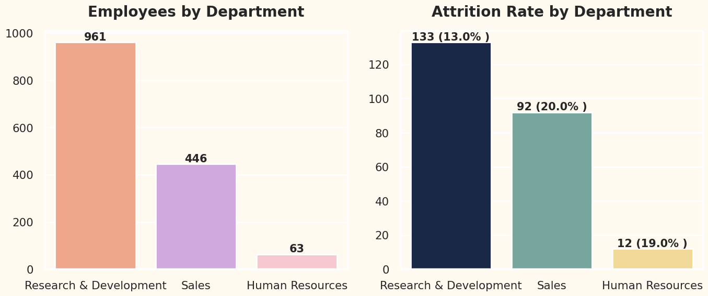
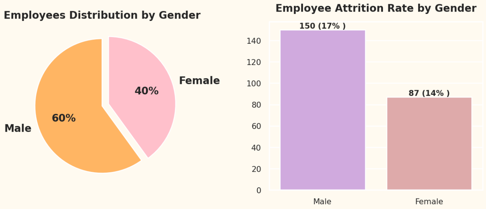
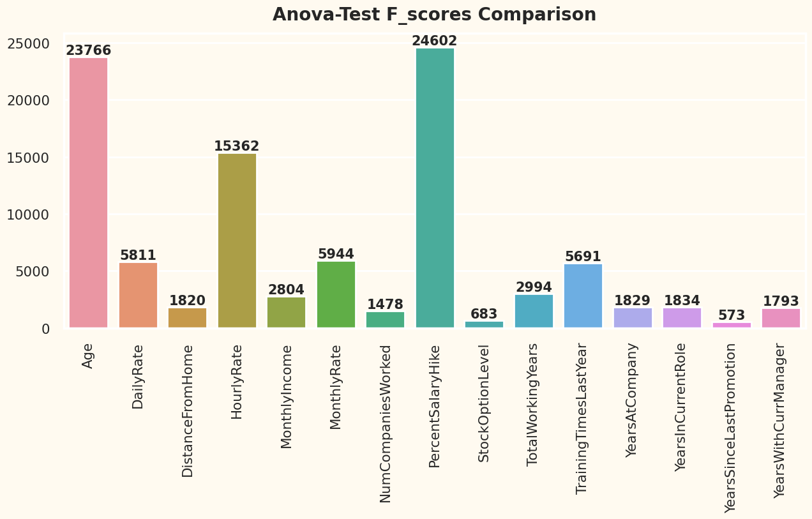

# HR Employee Attrition Analysis

## Project Overview

This project was completed as part of my MSc in Data Analytics at De Montfort University. It explores employee attrition and investigates workplace factors that may be associated with employees leaving an organisation.

The analysis combines **Python, exploratory data analysis (EDA), statistical testing and data visualisation** to examine patterns in employee attrition and support evidence-based retention decisions.

## Project Objectives

- Explore employee data to identify patterns and potential attrition factors.
- Clean and prepare data for statistical analysis.
- Apply statistical methods to investigate relationships between employee characteristics and attrition.
- Communicate findings through clear visualisations.
- Identify potential areas for further investigation into employee retention.

## Tools and Techniques

- **Python** — data analysis and preparation
- **Pandas and NumPy** — data manipulation
- **Exploratory Data Analysis (EDA)** — distributions and patterns
- **ANOVA** — examining differences between groups
- **Chi-square tests** — investigating associations between categorical variables
- **Data visualisation** — communicating analytical findings

## Key Findings

- The dataset recorded an overall employee attrition rate of approximately **16.12%**.
- Attrition patterns were explored across employee demographics and workplace characteristics.
- Statistical tests were used to investigate potential relationships between employee characteristics and attrition.
- The results highlight areas that organisations could investigate further when developing employee retention strategies.

## Visualisations

### 1. Overall Employee Attrition

### 2. Employee Attrition by Age

### 3. Employee Attrition by Gender

## Statistical Analysis

### ANOVA Feature Analysis

## Limitations

- The analysis is based on a historical IBM HR Analytics dataset.
- The findings may not generalise to every organisation or workforce.
- Other factors that influence employee decisions may not be captured in the available data.
- Statistical associations should not automatically be interpreted as evidence of causation.

## Project Report

The full dissertation is available here:

[**Read the MSc Dissertation (PDF)**](P2807642_DissertationProject.pdf)

## Key Learning

This project strengthened my ability to prepare and explore data, apply statistical methods, interpret analytical results, and communicate findings in a structured and business-relevant way.
